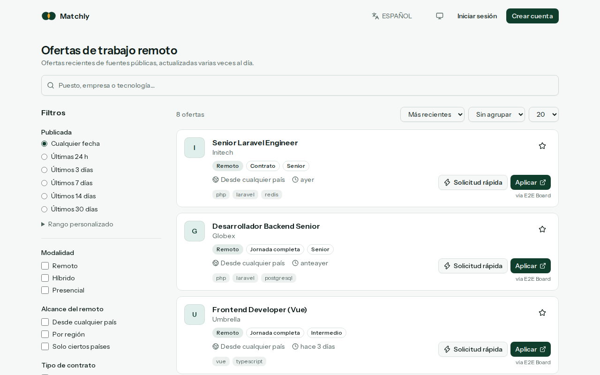
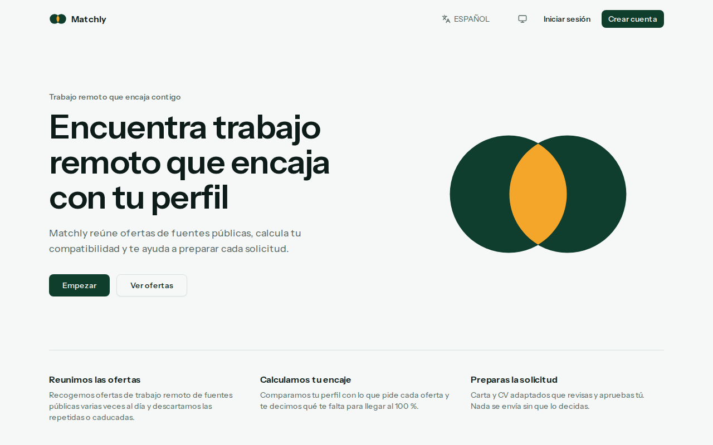
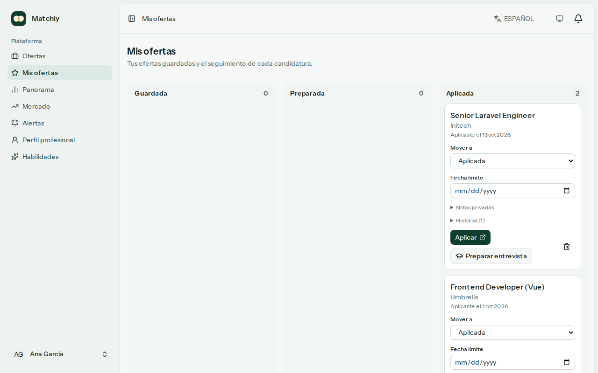
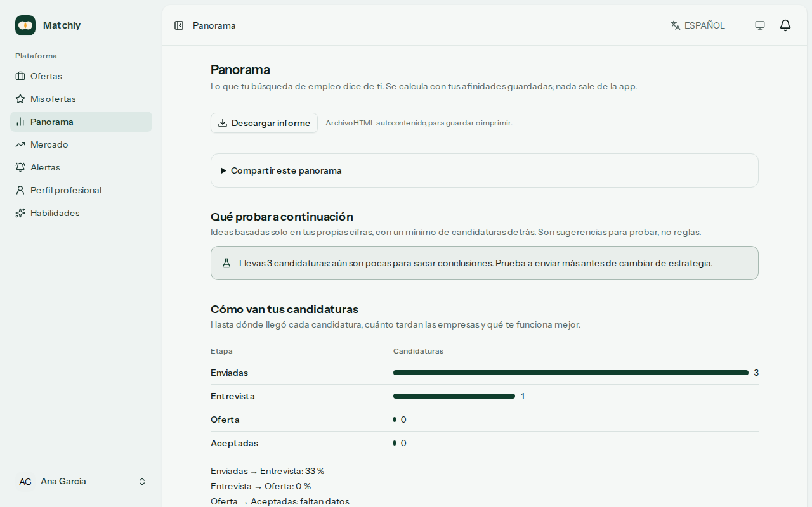
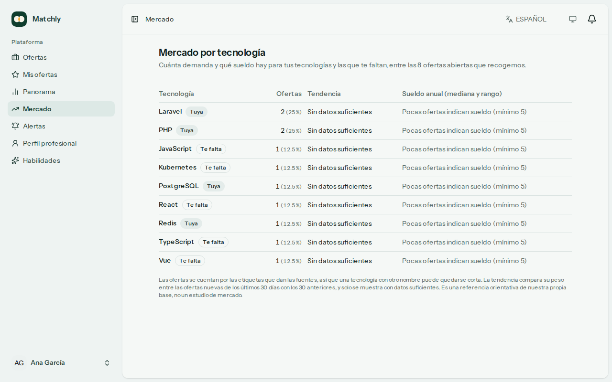
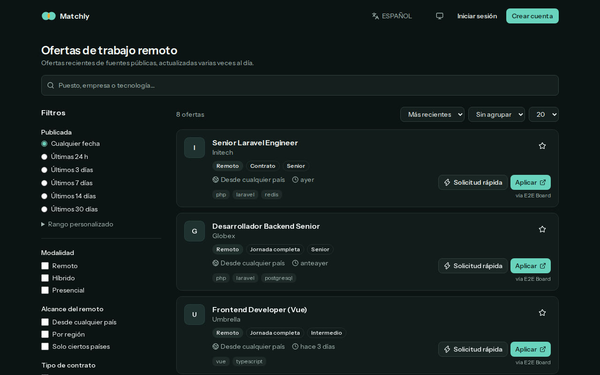
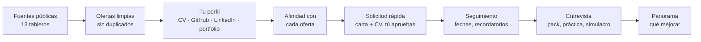

<p align="center">
  
</p>

<h1 align="center">Matchly</h1>

<p align="center">
  <strong>Encuentra trabajo remoto que encaje contigo, y llega a la entrevista preparado.</strong><br>
  Reúne ofertas de fuentes públicas, calcula cuánto encajas con cada una, prepara tu candidatura<br>
  y te acompaña hasta la respuesta. Tú decides; nada se envía por ti.
</p>

<p align="center">
  <a href="https://github.com/dmarsal90/Matchly/actions/workflows/ci.yml"></a>
  
  
  
  
  
  <a href="LICENSE"></a>
</p>

<p align="center">
  <a href="#cómo-se-ve">Capturas</a> ·
  <a href="#qué-hace">Qué hace</a> ·
  <a href="#puesta-en-marcha-docker">Puesta en marcha</a> ·
  <a href="docs/architecture.md">Arquitectura</a> ·
  <a href="docs/deployment.md">Despliegue</a>
</p>

<p align="center">
  
</p>

## Por qué Matchly

Buscar trabajo es repetir lo mismo cien veces: mirar tableros, adivinar si encajas, reescribir la carta, acordarte de hacer seguimiento. Matchly hace la parte mecánica y te deja el criterio.

- **Honesto.** Ninguna cifra se inventa: hay un mínimo de datos para cada comparación y las estimaciones se presentan como orientativas.
- **Tuyo.** Nunca se contacta con una empresa en tu nombre. La IA es opcional, con su propio consentimiento, y nada se guarda sin que lo revises.
- **Privado.** Consentimientos revocables que borran lo importado, textos personales cifrados, exportación y borrado de tu cuenta.
- **Verificable.** Más de 770 tests, E2E en escritorio y móvil, accesibilidad comprobada en claro y oscuro, y arquitectura vigilada por tests.

## Cómo se ve

<table>
  <tr>
    <td width="50%"><br><sub><b>Inicio</b>: de la oferta a la solicitud, en tres pasos.</sub></td>
    <td width="50%"><br><sub><b>Mis ofertas</b>: tablero con historial, fechas límite y seguimiento.</sub></td>
  </tr>
  <tr>
    <td width="50%"><br><sub><b>Panorama</b>: qué probar, cómo van tus candidaturas y qué aprender.</sub></td>
    <td width="50%"><br><sub><b>Mercado</b>: demanda y sueldo de tus tecnologías.</sub></td>
  </tr>
</table>

<p align="center"><br><sub>Modo claro y oscuro, en español, inglés y portugués.</sub></p>

## Qué hace



| | |
| --- | --- |
| 🔎 **Encontrar** | 13 fuentes gratuitas, filtros por modalidad, país, contrato, nivel y sueldo, alertas por app, tiempo real o correo, y **radar de empresas**. |
| 🎯 **Encajar** | Perfil de habilidades desde cuestionario, CV, GitHub, LinkedIn y portfolio; afinidad con cada oferta y qué te falta para llegar al 100 %. |
| ✍️ **Preparar** | Carta y CV adaptados (con o sin IA) que revisas y apruebas, PDF en tres plantillas legibles por ATS, notas de empresa aprobadas por ti y **extensión de navegador** que rellena los formularios. |
| 📋 **Seguir** | Tablero con historial, fechas límite, hasta dos seguimientos con borrador, nota de agradecimiento tras cada entrevista. |
| 🎤 **Entrevistar** | Preguntas probables con esquemas STAR de tu propio CV, respuestas honestas a tus carencias, práctica con comentarios y simulacro por turnos. |
| 📈 **Mejorar** | Panorama con embudo, calibración, qué probar a continuación, cursos (gratis primero), plan de estudio de 4 semanas en `.ics`, mercado por tecnología e informe descargable o compartible por enlace caducable. |

Todas las funciones, una a una, están [más abajo](#funciones-en-detalle).

## Stack

Laravel 13 · PHP 8.4 · Inertia 3 + Vue 3 (TypeScript) · Tailwind CSS 4 · PostgreSQL 17 · Redis 7 · Horizon · Reverb · Fortify · Pest · Larastan · Vitest · Docker.

> El nombre del producto se define **solo** en `APP_NAME` (`.env`) y como valor por defecto en `config/app.php`; todo lo demás lo lee de la configuración o del placeholder `:app` de las traducciones, y `tests/Architecture/BrandNameTest.php` falla si aparece escrito a mano.

## Puesta en marcha (Docker)

Requisitos: Docker 24+ con Compose v2 y `make`.

```sh
make setup   # crea .env, construye la imagen, instala dependencias y levanta todo
```

| Servicio  | URL                              |
|-----------|----------------------------------|
| App       | http://localhost:8000            |
| Horizon   | http://localhost:8000/horizon    |
| Mailpit   | http://localhost:8025            |
| Vite HMR  | http://localhost:5173            |
| Reverb    | ws://localhost:8080              |

Los puertos del host se cambian en `.env` (`APP_PORT`, `FORWARD_DB_PORT`, `VITE_PORT`, …) si chocan con otros proyectos.

Comandos habituales (`make help` los lista todos):

```sh
make up / make down      # arrancar / parar
make shell               # shell en el contenedor app
make migrate             # migraciones
make test                # Pest + Vitest
make e2e                 # Playwright: flujos clave de punta a punta (ver «Tests»)
make coverage            # cobertura de PHP; falla por debajo del 90 %
make check               # lo mismo que la CI: Pint, ESLint, Prettier, Larastan, vue-tsc y tests
make logs s=horizon      # logs de un servicio
make horizon-restart     # recargar workers tras cambiar código de jobs
```

Xdebug viene instalado e inactivo: pon `XDEBUG_MODE=debug` en `.env` y ejecuta `docker compose up -d`.

## Sin Docker

PHP 8.3+ (pdo_pgsql, redis, intl, zip, pcntl), Composer, Node 22, PostgreSQL y Redis locales:

```sh
composer setup           # dependencias, .env, APP_KEY, migraciones y build
composer dev             # servidor, cola, logs y Vite
```

Los tests usan SQLite en memoria (`phpunit.xml`) y no necesitan servicios.

## Tests

| Capa | Herramienta | Qué cubre |
| --- | --- | --- |
| Unitarios y de feature | Pest (`tests/Unit`, `tests/Feature`) | Normalizadores de proveedores, clasificador, puntuación, ZIP de LinkedIn con fixtures, Actions y endpoints. IA, GitHub y HTTP externo con `Http::fake`. SQLite en memoria y, en CI, también PostgreSQL (`make test-pgsql`). |
| Arquitectura | Pest (`tests/Architecture`) | Fronteras entre módulos, `strict_types`, marca solo desde `APP_NAME`, sin texto fijo en las plantillas Vue y mismas claves en es/en/pt. |
| Frontend | Vitest | Composables y utilidades de `resources/js`. |
| End-to-end | Playwright (`tests/e2e`) | Registro con verificación por correo, cuestionario, importación de LinkedIn, búsqueda (texto completo de PostgreSQL) y filtros en escritorio y móvil, recomendaciones, solicitud rápida con PDF, alertas con resumen por correo y baja en un clic, historial de candidaturas, recordatorios de seguimiento, preparación de entrevista, panorama y WCAG 2.2 AA con axe en modo claro y oscuro. |

Los E2E corren contra su propia base de datos (`app_e2e`) y un servidor aparte en el puerto 8001 (`docker/scripts/e2e.sh`), así que nunca tocan los datos de desarrollo. Antes de cada ejecución se rehace la base con `E2eSeeder`, y los correos se leen de Mailpit. Playwright corre en el host:

```sh
make e2e-install         # una vez: descarga Chromium
make e2e                 # compila los assets, levanta el servidor y ejecuta la suite
make e2e a="--ui"        # modo interactivo (o --headed, --project=mobile, -g "alertas")
npx playwright show-report
```

Con un servidor ya levantado en otro sitio: `E2E_BASE_URL=http://… npx playwright test`. `E2E_RESET_COMMAND`, `E2E_ARTISAN_COMMAND` y `E2E_SERVER_COMMAND` permiten ejecutarla sin Docker (por ejemplo en CI).

## Imagen Docker

Un único `Dockerfile` multi-stage sirve para todos los procesos:

| Target     | Uso                                                                 |
|------------|---------------------------------------------------------------------|
| `dev`      | desarrollo: Composer, Node y Xdebug; el código se monta como volumen |
| `prod`     | producción (target por defecto): nginx + php-fpm, OPcache, usuario no root, `HEALTHCHECK` |

El rol del contenedor lo elige el primer argumento del entrypoint (`docker/entrypoint.sh`):

| Rol         | Proceso                                   | Migraciones |
|-------------|-------------------------------------------|-------------|
| `web`       | nginx + php-fpm (supervisord)             | sí          |
| `fpm`       | php-fpm (desarrollo)                      | sí          |
| `horizon`   | workers de cola gestionados por Horizon   | no          |
| `worker`    | `queue:work` simple                       | no          |
| `scheduler` | `schedule:work`                           | no          |
| `reverb`    | servidor WebSocket                        | no          |

```sh
make prod-image          # construir la imagen de producción en local
```

## Ingesta de ofertas

Fuentes gratuitas: Remotive, Remote OK, Jobicy, Himalayas, Arbeitnow, We Work Remotely (RSS), Adzuna y Jooble (con clave gratuita), y los tableros públicos de Greenhouse, Lever, Ashby, Workable y SmartRecruiters de las empresas de la tabla `ats_companies`.

- El scheduler ejecuta `jobs:ingest` cada 10 minutos. Cada fuente solo se lanza cuando ha pasado su `interval` (que respeta sus términos de uso) y el back-off por fallos. Se encola un job por fuente en la cola `ingestion`.
- Flujo: normalizar → descartar lo antiguo, lo presencial o lo incompleto → sanear HTML → clasificar modalidad, alcance, regiones, categoría, rol y seniority → marcar sospechosas → upsert idempotente → cerrar lo que la fuente ya no lista → evento `JobsIngested`.
- Deduplicación: por `(fuente, id externo)` dentro de una fuente, y por URL canónica o título + empresa normalizados entre fuentes. Gana la primera vista.
- `jobs:close-expired` (cada hora) y `jobs:check-links` (cada noche) cierran las ofertas caducadas o con enlace muerto.
- La UI consulta siempre la base de datos, nunca las APIs externas.

```sh
php artisan jobs:ingest                    # encola las fuentes que tocan
php artisan jobs:ingest remotive --sync -v # una fuente, ahora, con motivos de descarte
php artisan jobs:sources                   # estado de cada fuente
```

Cómo añadir una fuente: [docs/adding-a-job-provider.md](docs/adding-a-job-provider.md).

## Funciones en detalle

Además de la solicitud rápida, Matchly acompaña la candidatura hasta el final. Todo es para ti: nunca se contacta con una empresa en tu nombre.

- **Historial** en cada tarjeta de «Mis ofertas»: cambios de estado (incluidos oferta, aceptada, declinada y sin respuesta), rondas de entrevista, seguimientos y notas privadas.
- **Recordatorios de seguimiento**: `php artisan applications:follow-up` (programado a diario) avisa de las candidaturas sin respuesta tras `FOLLOW_UP_DAYS` días (10 por defecto) y adjunta un borrador que puedes copiar. Hay un segundo aviso, con un texto más firme, si el primer seguimiento tampoco obtiene respuesta; nunca más de dos. Tras cada ronda de entrevista, la línea de tiempo ofrece un borrador de nota de agradecimiento.
- **Fecha límite** por candidatura, que pones tú (para presentarla o para responder a una oferta). `php artisan applications:deadlines` (diario) avisa `DEADLINE_WARNING_DAYS` días antes (2 por defecto), en la app, en tiempo real y por correo si lo consientes.
- **Preparar entrevista**: preguntas probables con esquemas STAR sacados de tu CV, respuestas honestas para lo que aún no sabes y preguntas para la empresa. Funciona sin IA; con IA se redacta mejor, pero nunca se inventa experiencia.
- **Panorama** (`/insights`): qué habilidades te abrirían más ofertas, con **cursos para cada una (gratuitos primero, de pago después)** y las ofertas que tienes más cerca del 100 %, y cómo van tus candidaturas (conversión por etapa, tiempos de respuesta, resultados por fuente y área). `php artisan courses:check` verifica que los enlaces del catálogo (`config/courses.php`) siguen vivos.
- **Práctica de entrevista**: bajo cada pregunta del pack escribes tu respuesta (se guarda cifrada) y pides comentarios. Sin IA son comprobaciones sencillas (longitud, un resultado concreto, nombrar la tecnología); con IA, una crítica de cómo cuentas la respuesta que no añade datos ni la reescribe.
- **Informe sin conexión**: `/insights` se descarga como un único archivo HTML autocontenido (sin scripts ni recursos externos) para guardar, imprimir o compartir.
- **Calibración y estimaciones**: el panorama compara la afinidad media de las ofertas que llegaron a entrevista con las rechazadas o sin respuesta (solo una comparación; no ajusta nada), y estima unas horas orientativas por habilidad que falta, según su tipo.
- **Referencia salarial** en la ficha de la oferta: mediana y rango central de ofertas parecidas (misma categoría, nivel y moneda) que indican sueldo en nuestra propia base, solo con al menos 5 y siempre presentada como orientativa, no como estudio de mercado.
- **Plantillas de CV**: clásica, moderna y compacta al descargar el PDF. Las tres son una sola columna de texto real con los mismos encabezados, para que un sistema de seguimiento de candidatos las lea igual.
- **Portfolio como fuente de habilidades**: Matchly lee tu web pública (y unas pocas páginas habituales de tu dominio, respetando `robots.txt`) y propone las tecnologías que menciona. Lo revisas antes de guardar; no se inventan niveles ni años. Tiene su propio consentimiento revocable.
- **Qué probar a continuación**: ideas concretas sacadas solo de tus cifras (a qué fuente o área dedicar más esfuerzo, si te conviene probar ofertas de menor afinidad, si seguir antes), cada una con un mínimo de candidaturas detrás.
- **Simulacro de entrevista**: las preguntas de tu pack una a una, con una guía de tiempo, y un resumen final que ordena tus respuestas de más floja a más sólida.
- **Plan de estudio de 4 semanas** a partir de las horas orientativas de lo que te falta y de las horas que tengas por semana, descargable como calendario `.ics`.
- **Radar de empresas** (`/radar`): sigue una empresa desde su oferta y `php artisan alerts:radar` (diario) te avisa de sus ofertas nuevas entre las que ya recoge la app. No visita sus webs.
- **Mercado** (`/market`): demanda, tendencia y sueldo (mediana y rango, con muestra mínima) de tus tecnologías y de las que te faltan, según las etiquetas de las ofertas abiertas.
- **Compartir el panorama**: un enlace de solo lectura, caducable (1, 7 o 30 días) y revocable, a una copia congelada del informe; sin tu nombre salvo que lo pidas.
- **Lo que sé de la empresa**: en la ficha de cada oferta anotas datos de la empresa, o dejas que Matchly lea su web pública (respetando `robots.txt`) y te sugiera frases suyas. Solo lo que apruebes se usa en la carta y en las preguntas para la entrevista; nunca se inventa nada de la empresa.

## Extensión del navegador

La carpeta [`extension/`](extension/README.md) es una extensión (Chrome, Edge, Brave) que rellena los formularios de empleo con los datos de las solicitudes que ya aprobaste y adjunta el CV en PDF. Solo lee, solo rellena campos vacíos y **nunca envía el formulario**. Las preguntas abiertas del formulario (cajas de texto con una pregunta como etiqueta) las responde con un borrador hecho solo con tu CV y la oferta (con IA si ya diste tu consentimiento, con una plantilla si no), que tú revisas. Con el botón **Guardar esta oferta** guarda en tu lista la oferta de la página que estás viendo (LinkedIn, Indeed, la web de la empresa…): solo lee los datos públicos estructurados de la oferta (JSON-LD `JobPosting`), nunca nada tras un inicio de sesión, y si Matchly ya la tenía la reutiliza. Se conecta con un token que creas en *Ajustes › Extensión del navegador* y que solo ve las solicitudes aprobadas.

## Estructura

El código de negocio vive en `app/Modules/<Dominio>/{Domain,Application,Infrastructure,Http}`. Los tests de `tests/Architecture` hacen cumplir las fronteras: `Domain` no depende del framework, los controladores no tocan la base de datos y todo archivo declara `strict_types`.

Más detalle en [docs/architecture.md](docs/architecture.md): módulos, flujos (ingesta, compatibilidad, solicitud rápida, seguimiento y entrevistas, alertas), colas y privacidad.

- [Añadir una fuente de ofertas](docs/adding-a-job-provider.md)
- [Añadir un proveedor de IA](docs/adding-an-ai-provider.md)
- [Entregabilidad del correo (SPF, DKIM, DMARC)](docs/email-deliverability.md)

## CI/CD y despliegue

- **CI** (`.github/workflows/ci.yml`, en cada PR): Pint, Larastan, Pest en SQLite y en PostgreSQL (con cobertura mínima del 90 %), ESLint, Prettier, vue-tsc, Vitest, build del frontend, Playwright y build de la imagen de producción.
- **CD** (`.github/workflows/deploy.yml`, en `main`): publica la imagen en GHCR para amd64 y arm64 (`sha-<commit>` y `latest`), la escanea con Trivy y despliega en staging. Producción y los rollbacks se lanzan a mano con la etiqueta que quieras desplegar.
- **Dependabot** para Composer, npm, GitHub Actions y Docker.

La misma imagen sirve para todos los procesos y entornos. [docs/deployment.md](docs/deployment.md) explica cada destino:

| Destino | Ficheros |
| --- | --- |
| VPS con Docker Compose (Caddy + HTTPS, backups diarios, rotación de logs) | `docker-compose.prod.yml`, `deploy/vps/`, `deploy/env.production.example` |
| Staging gratis en Oracle Cloud (Always Free, ARM) | [docs/oracle-free-staging.md](docs/oracle-free-staging.md), `deploy/oracle/` |
| Laravel Cloud · Laravel Forge | pasos en la guía |
| Render | `deploy/render.yaml` (Blueprint) |
| Fly.io | `deploy/fly.toml` |
| Railway | pasos en la guía |
| Demo mínima (un servicio, cola `sync`, cron externo) | pasos en la guía |

La guía también cubre cómo escalar los workers por separado, el rollback y la restauración de backups. `GET /up` es el endpoint de salud que usan los healthchecks y los balanceadores.

## Contribuir

Lee [CONTRIBUTING.md](CONTRIBUTING.md) y el [código de conducta](CODE_OF_CONDUCT.md). Las vulnerabilidades se reportan en privado según [SECURITY.md](SECURITY.md).
